# ECG-DSP-Toolkit

FFT, spectral analysis and filter design for ECG denoising, built from first principles in Python
(NumPy / SciPy / Matplotlib / wfdb). Everything runs on a laptop CPU.

> **Status of the numbers in this repo.** All code, unit tests and plots are included, but **no ECG result
> table is pre-filled**: the table in [Results](#results) is generated by *your* run on the real MIT-BIH /
> NSTDB data. Where this README describes what a figure "should" show, that is what the theory predicts;
> confirm it against your own output and investigate if it differs.

---

## Key results at a glance

**Where the noise lives**

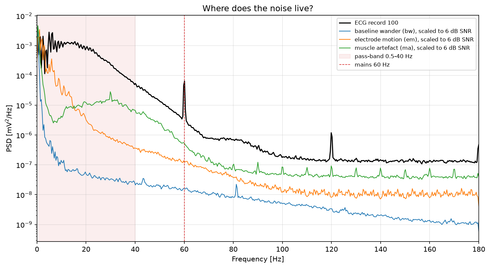

<sub>Power spectra of ECG record 100 and the three NSTDB noise types, scaled to 6 dB SNR, against the 0.5-40 Hz pass-band. Record 100 itself shows a 60 Hz mains peak and its 120 Hz harmonic.</sub>

**Spectrogram (own STFT implementation)**

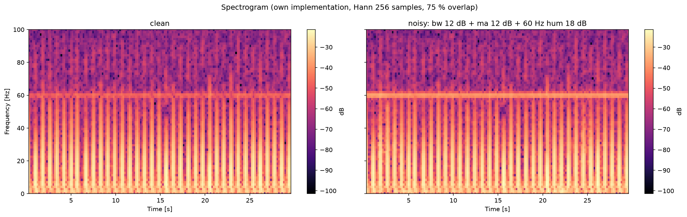

<sub>Clean record vs a synthetic mix of baseline wander, muscle noise and 60 Hz hum. Vertical stripes are QRS complexes; the horizontal line near 60 Hz is mains interference (already faintly present in the raw record).</sub>

**Own FFT vs numpy.fft on real ECG**

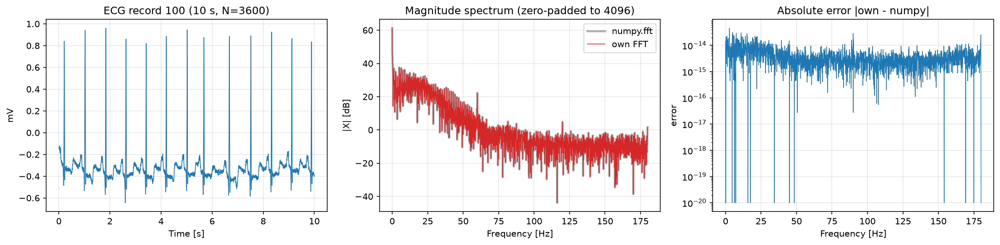

<sub>The hand-written radix-2 FFT matches numpy to about 1e-13 (rounding error only).</sub>

**Bilinear transform and pre-warping**

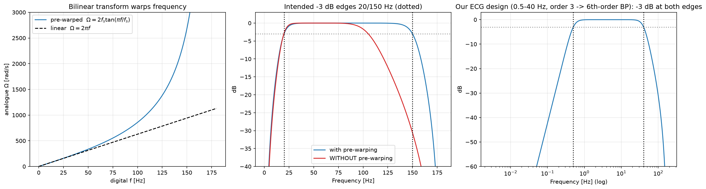

<sub>Without pre-warping, a 20/150 Hz design lands near 20/105 Hz; with pre-warping the edges are exact.</sub>

**Phase distortion on one QRS complex**

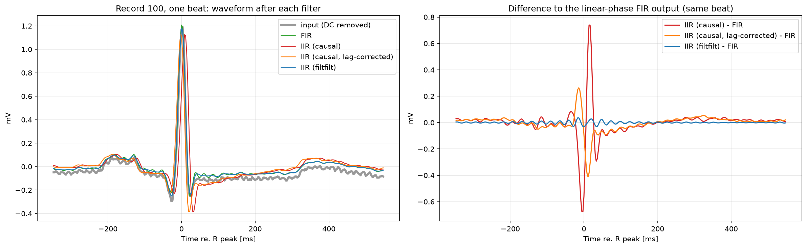

<sub>R-peak shift in one beat: FIR -2.8 ms, causal IIR +5.6 ms, filtfilt -2.8 ms (one sample is 2.78 ms at 360 Hz).</sub>

**SNR improvement vs input SNR**

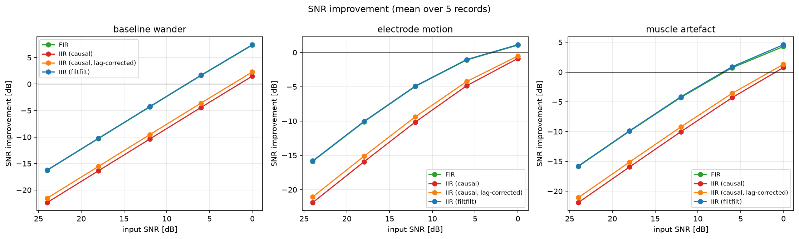

<sub>Gains are real where noise dominates (baseline wander about +7 dB at 0 dB input) and negative at high input SNR because the raw record is the reference. See "Reading the real-data results" below.</sub>

**Before / after on electrode-motion noise**

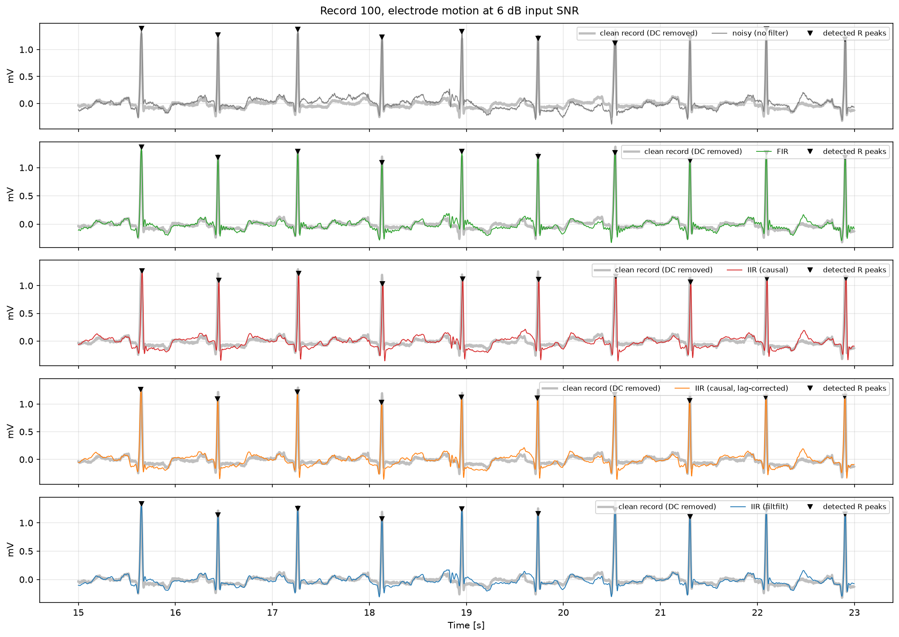

<sub>Electrode motion overlaps the ECG band and is the hardest noise for linear filters.</sub>

More figures and how to read them: see [Section 6](#6-figures-and-how-to-read-them).

---

## 1. Motivation

An ECG is a small (~1 mV) signal sitting on three classic contaminants that live in different parts of the
spectrum, which is why filter design is the heart of ECG processing:

| Contaminant | Typical band | Source |
|---|---|---|
| Baseline wander (`bw`) | < ~0.5 Hz | breathing, body movement, electrode drift |
| Electrode motion (`em`) | ~1-10 Hz, bursty | skin-electrode impedance changes |
| Muscle artefact (`ma`) | broadband, mostly > 20 Hz | EMG |
| Mains interference | 50 or 60 Hz line | power lines |

The diagnostic content (QRS ~ 5-25 Hz, P/T waves ~ 0.5-10 Hz) overlaps with some of these, so every filter is
a trade-off between noise rejection, waveform distortion, delay and cost. This project implements the DSP
blocks by hand (so every line can be explained), compares them with SciPy, and measures the trade-offs on real
recordings with exact, reproducible SNRs.

## 2. Repository structure

```
ecg-dsp-toolkit/
  README.md  requirements.txt  conftest.py  .gitignore
  src/
    fft.py        radix-2 DIT FFT (recursive + iterative), inverse, zero padding, naive DFT
    windows.py    rectangular / Hann / Hamming / Blackman + figures of merit
    psd.py        periodogram, Welch PSD, spectrogram (own FFT)
    fir.py        windowed-sinc band-pass from the ideal impulse response, order rule
    iir.py        Butterworth band-pass from scratch (prototype -> LP2BP -> prewarp -> bilinear), SOS, notch
    noise.py      exact-SNR noise scaling, synthetic stand-in noise (tests only)
    metrics.py    SNR, SNR improvement, RMSE, beat matching, Se / PPV / F1
    io.py         wfdb loading of MIT-BIH + NSTDB, synthetic ECG (tests / offline smoke runs only)
    analysis.py   *extra*: magnitude / phase / group delay / pole-zero / impulse / step plots
    peaks.py      *extra*: Pan-Tompkins-style R-peak detector
    pipeline.py   *extra*: the filter bank compared in the experiments
  scripts/        01..07 numbered scripts (one per build step) + run_all.py
  notebooks/      01_ecg_dsp_walkthrough.ipynb (guided tour, no stored outputs)
  tests/          pytest suite (161 tests)
  data/           download_data.py  (downloaded files go in data/mitdb, data/nstdb)
  results/figures/  generated figures      docs/  study plan + interview guide
```
`analysis.py`, `peaks.py` and `pipeline.py` are the only files beyond the requested list; they keep the
scripts short.

## 3. How to run

```bash
python -m venv .venv && source .venv/bin/activate      # Windows: .venv\Scripts\activate
pip install -r requirements.txt

pytest -q                               # unit tests (no data needed; falls back to synthetic ECG)
python data/download_data.py            # ~25 MB from PhysioNet: records 100,101,119,200,207 + bw,em,ma
python scripts/run_all.py --update-readme    # all 7 steps; fills the results block below
```

Useful options (accepted by `run_all.py` and by the individual scripts where relevant):

```bash
python scripts/run_all.py --mains-hz 50        # 50 Hz notch for Indian recordings (default 60 for MIT-BIH)
python scripts/run_all.py --full               # score whole 30-min records instead of 5-min excerpts
python scripts/06_ecg_experiments.py --with-mains   # add a synthetic mains-hum noise type (what the notch is for)
python scripts/run_all.py --synthetic          # offline smoke test; writes to results_synthetic/ only
jupyter notebook notebooks/01_ecg_dsp_walkthrough.ipynb
```
Everything is seeded (`--seed`, default 42), so reruns are identical.

## 4. Assumptions and design decisions (the ambiguities, resolved)

1. **SNR definition.** Power = mean square of the DC-removed signal; `SNR = 10 log10(P_s / P_n)`. DC is
   excluded because MIT-BIH offsets carry no information and the band-pass removes DC anyway.
2. **"Clean" reference = the MIT-BIH record itself.** It already contains its own noise (records 200 and 207
   are known to be noisy/arrhythmic). So SNRs are *relative to that record*, and a filter also "loses" whatever
   in-band-excluded content the record contains. At high input SNR, SNR improvement can therefore be negative.
3. **Lead / channel.** Channel 0 (MLII) of every record and of the NSTDB noise records.
4. **Noise segment.** A seeded random offset into the 30-minute NSTDB record, a different one per (record, noise type).
5. **Excerpt length.** 300 s per record by default (`--full` for 30 min). The first and last 5 s are excluded from
   scoring (`--trim-s`) so filter edge transients do not pollute the metrics.
6. **FIR design.** Hamming window, transition width 0.5 Hz at the low edge, giving M = ceil(3.3·360/0.5) = 2376
   (2377 taps, 6.6 s long, 3.3 s constant delay). Cut-offs 0.5/40 Hz are **-6 dB points** (mid-transition). The
   delay is removed (offline "zero-delay" application) because linear phase makes that exact.
7. **IIR design.** Butterworth, prototype order 3 (6th-order band-pass = 3 biquads) with -3 dB edges at 0.5/40 Hz, plus
   a notch with Q = 30. The notch handles the narrow mains line so the 40 Hz edge need not be steep.
8. **Causal IIR is not delay-compensated** in the main comparison (that is what real-time filtering gives). A diagnostic
   column, "IIR (causal, lag-corrected)", removes the median pass-band group delay (5-30 Hz) to separate a pure
   time shift from waveform distortion.
9. **`filtfilt`** is implemented with `sosfiltfilt` (the SOS version of `filtfilt`). It squares the magnitude, so its
   edges are -6 dB, not -3 dB.
10. **Mean removal.** All three filters start by subtracting the signal mean (avoids a giant edge step for the FIR).
11. **R-peak scoring.** Reference = expert **beat** annotations (non-beat markers dropped). Match tolerance 150 ms
    (ANSI/AAMI EC57), greedy one-to-one. Detector = Pan-Tompkins-style (see `peaks.py`); *its own* internal 5-15 Hz
    band-pass is zero-phase, so timing shifts come from the filter under test, not the detector. "Before filtering"
    = detector run on the noisy signal.
12. **Mains.** NSTDB has no 50/60 Hz noise, so the headline experiment covers `bw/em/ma` as specified; a synthetic
    mains sinusoid is available with `--with-mains`. The notch frequency is the parameter `--mains-hz` / `mains_hz`.
13. **Synthetic ECG** (`src/io.py`) exists only so tests and CI run offline. Scripts run with `--synthetic` write to a
    separate folder and refuse to update this README.
14. **Environment.** Developed against Python 3.12 / NumPy 2.x / SciPy 1.17; written to be compatible with 3.10+.
    The PhysioNet download step could not be exercised in my build sandbox (no internet to PhysioNet), so it is the one
    part of the repo I have *not* run end to end: if `download_data.py` fails, it prints the exact files to fetch manually.

## 5. Theory summary

### 5.1 DFT and the radix-2 FFT
$$X[k]=\sum_{n=0}^{N-1}x[n]\,W_N^{kn},\qquad W_N=e^{-j2\pi/N}$$
Directly: $N$ multiply-adds per bin $\Rightarrow O(N^2)$. Split into even/odd samples ($E,O$ are $N/2$-point DFTs;
$W_N^2=W_{N/2}$, $W_N^{k+N/2}=-W_N^k$):
$$X[k]=E[k]+W_N^kO[k],\qquad X[k+\tfrac N2]=E[k]-W_N^kO[k]$$
Recursing gives $\log_2N$ stages of $N/2$ butterflies: $O(N\log N)$. The iterative form first permutes the input
into bit-reversed order, then does the stages in place. Inverse: $x=\overline{\mathrm{FFT}(\overline X)}/N$.
Zero padding to $2^m$ samples the same DTFT on a denser grid (interpolation, no new information).

### 5.2 Windows, leakage, Welch
Truncating to $N$ samples multiplies by a window; in frequency every tone is convolved with $W(f)$. The **main-lobe
width** sets resolution, the **sidelobe level** sets dynamic range, and they trade off:

| window | peak sidelobe | main lobe (null-null) | roll-off |
|---|---|---|---|
| rectangular | -13 dB | 2 bins | 6 dB/oct |
| Hann | -31 dB | 4 bins | 18 dB/oct |
| Hamming | -43 dB | 4 bins | 6 dB/oct |
| Blackman | -58 dB | 6 bins | 18 dB/oct |

Periodogram $P[k]=|X_w[k]|^2/(f_s\sum w^2)$ has variance that does not shrink with $N$. **Welch** averages $K$
overlapping windowed segments: variance $\propto 1/K$ at the cost of resolution $\approx f_s/N_{seg}$. One-sided PSDs
double bins $1..N/2-1$.

### 5.3 Windowed-sinc FIR
Ideal band-pass: $h_d[m]=\frac{2f_2}{f_s}\mathrm{sinc}\!\left(\frac{2f_2m}{f_s}\right)-\frac{2f_1}{f_s}\mathrm{sinc}\!\left(\frac{2f_1m}{f_s}\right)$,
$m=n-M/2$. Truncate to $M+1$ taps and multiply by a window $w[n]$. Transition width and order:
$$\Delta f\approx\frac{K f_s}{M}\;\Rightarrow\; M=\left\lceil\frac{K f_s}{\Delta f}\right\rceil,\quad K=0.9,\,3.1,\,3.3,\,5.5\ \text{(rect, Hann, Hamming, Blackman)}$$
Symmetric $h[n]=h[M-n]$ gives $H(e^{j\omega})=A(\omega)e^{-j\omega M/2}$: exactly **linear phase**, constant group delay
$M/2$ samples. Narrow transitions near DC are expensive: 0.5 Hz at 360 Hz needs 2377 taps.

### 5.4 Butterworth IIR, bilinear transform, pre-warping
Analogue low-pass prototype: $|H(j\Omega)|^2=1/(1+\Omega^{2N})$, poles $p_k=e^{j\pi(2k+N-1)/2N}$. Steps implemented in `iir.py`:

1. **Pre-warp** the digital edges: $\Omega=2f_s\tan(\pi f/f_s)$, because the bilinear map $s=2f_s\frac{z-1}{z+1}$ compresses the analogue
   axis non-linearly: $\Omega=2f_s\tan(\omega/2)$.
2. **LP to BP**: $s\to\frac{s^2+\Omega_0^2}{B\,s}$, $\Omega_0=\sqrt{\Omega_1\Omega_2}$, $B=\Omega_2-\Omega_1$ (each pole becomes two; $N$ zeros at $s=0$).
3. **Bilinear** map every pole/zero: $z=\frac{2f_s+s}{2f_s-s}$ (zeros at $s=0\to z=1$, extra zeros at $s=\infty\to z=-1$).
4. **Second-order sections.** With edges at 0.5 Hz and $f_s=360$ Hz the poles sit ~0.009 rad from $z=1$; a single high-order polynomial
   is ill-conditioned. Cascaded biquads are not (`scripts/04` prints the failure of the $(b,a)$ form at orders 6-8).

**Notch:** $H(z)=b_0\frac{1-2\cos\omega_0z^{-1}+z^{-2}}{1-2r\cos\omega_0z^{-1}+r^2z^{-2}}$, zeros on the unit circle, $BW=f_0/Q$.

**Zero-phase filtering (`filtfilt`):** filter, reverse, filter, reverse. Net response $|H|^2$ with zero phase; non-causal (offline only);
-3 dB edges become -6 dB. Causal filtering has *non-constant group delay*, so the QRS (broadband) is reshaped.

### 5.5 Exact SNR scaling and metrics
$$\alpha=\sqrt{\frac{P_s}{P_n\,10^{\mathrm{SNR}/10}}},\qquad y=s+\alpha n\;\Rightarrow\;10\log_{10}\frac{P_s}{\alpha^2P_n}=\mathrm{SNR}$$
Output $\mathrm{SNR}=10\log_{10}\frac{\sum\tilde s^2}{\sum(\tilde y-\tilde s)^2}$ (tilde = DC removed), $\Delta\mathrm{SNR}=\mathrm{SNR}_{out}-\mathrm{SNR}_{in}$,
$\mathrm{RMSE}=\sqrt{\mathrm{mean}(\tilde y-\tilde s)^2}$, $Se=TP/(TP+FN)$, $PPV=TP/(TP+FP)$, $F1=2\,Se\,PPV/(Se+PPV)$.

## 6. Figures and how to read them

Run `python scripts/run_all.py`; figures appear in `results/figures/`. Descriptions below say what the theory predicts;
data-dependent plots (marked *data*) should be checked against your own run.

| Figure | Interpretation (2 lines) |
|---|---|
| [`01_fft_vs_numpy_ecg.png`](results/figures/01_fft_vs_numpy_ecg.png) | The ECG spectrum from our FFT lies exactly under numpy's; the error panel sits at ~1e-13 or below (rounding only). A 3600-sample ECG is zero-padded to 4096, which interpolates the spectrum without changing it. |
| [`01_fft_benchmark.png`](results/figures/01_fft_benchmark.png) | The naive DFT curve bends up to slope 2 (N²) while the radix-2 curves grow ~N log N; numpy is far faster in absolute terms because it is C. At small N the Python-vectorised iterative version is dominated by per-call overhead, so only the large-N end shows the asymptote (the reference laws are anchored there). *timings machine-dependent* |
| [`02_windows.png`](results/figures/02_windows.png) | Rectangular has the narrowest main lobe but -13 dB sidelobes decaying slowly; Hann/Hamming/Blackman widen the main lobe to 4-6 bins and push sidelobes to -31/-43/-58 dB. This is the resolution vs dynamic-range trade-off in one picture. |
| [`02_leakage_demo.png`](results/figures/02_leakage_demo.png) | Left: two equal tones 2.3 bins apart are clearly resolved by rectangular, barely by Hann, merged by Blackman. Right: a tone 50 dB weaker is hidden under rectangular leakage but visible with Hann/Blackman. |
| [`02_welch_vs_scipy.png`](results/figures/02_welch_vs_scipy.png) | Our Welch lies on top of `scipy.signal.welch` (relative difference ~1e-14); the single periodogram is visibly much noisier. *data* The ECG PSD should be dominated by energy below ~25 Hz with a QRS-related bump around 5-20 Hz. |
| [`02_noise_psd.png`](results/figures/02_noise_psd.png) | *data* Expect `bw` energy concentrated below ~1 Hz, `em` at low frequencies and bursty, `ma` broadband and relatively strong above 20 Hz, against the shaded 0.5-40 Hz pass-band. This is the empirical justification for the band edges. |
| [`02_spectrogram.png`](results/figures/02_spectrogram.png) | One vertical stripe per beat (broadband QRS). Record 100 already contains real 60 Hz mains hum, so a faint horizontal line near 60 Hz appears even in the "clean" panel; the noisy panel (synthetic mix: wander 12 dB + muscle 12 dB + 60 Hz hum 18 dB) makes that line stronger and adds low-frequency and high-frequency haze. |
| [`03_fir_design.png`](results/figures/03_fir_design.png) | Taps grow as 1/Δf and with window K (2377 at 0.5 Hz/Hamming). Our response overlays `firwin` exactly; Hamming trades a little transition width for ~53 dB stop-band versus the rectangular window's Gibbs ripple. |
| [`03_fir_linear_phase.png`](results/figures/03_fir_linear_phase.png) | Phase is a straight line −ωM/2 in the pass-band, group delay is flat at 3.3 s, deviation from linear is numerically zero. Symmetric taps are the reason. |
| [`04_iir_bilinear_prewarp.png`](results/figures/04_iir_bilinear_prewarp.png) | The tan warping curve diverges from the linear map near Nyquist. Without pre-warping a 20/150 Hz design lands near 20/105 Hz (the script prints the measured edges); with it, edges are exact. |
| [`04_iir_design.png`](results/figures/04_iir_design.png) | Higher order gives steeper skirts but larger low-frequency group delay. The (b,a) polynomial form deviates from SOS as order grows and goes unstable at higher orders (the script prints the max pole radius). |
| [`04_phase_distortion_qrs.png`](results/figures/04_phase_distortion_qrs.png) | *data* FIR and `filtfilt` keep the R peak where the input has it; the causal IIR shifts it later by a few ms and bends the QRS/ST shape. The difference panel shows where the causal filter departs from the linear-phase output. |
| [`04_notch_demo.png`](results/figures/04_notch_demo.png) | The notch carves a narrow null at the mains frequency in the PSD while leaving neighbouring frequencies and the ECG band untouched. Notch response: deep null at f0, ~0 dB elsewhere. |
| `05_report_*.png` (5 files) | Per filter: magnitude, phase, group delay, pole-zero, impulse and step responses. FIR: flat group delay, symmetric impulse response (pole-zero shown for a 41-tap surrogate because a 2376-degree polynomial cannot be root-found reliably). Causal IIR: all poles inside the unit circle, zeros at z=±1 (DC/Nyquist) and on the circle at the notch, non-flat group delay peaking near 0.5 Hz and at the notch. Filtfilt: zero phase, symmetric (non-causal) impulse response with squared magnitude. |
| `06_before_after_{bw,em,ma}.png` | *data* Stacked traces (noisy, FIR, IIR causal, lag-corrected, filtfilt) over the clean record at 6 dB with detected R peaks. Expect wander removed cleanly, muscle noise reduced but not removed, and electrode motion the hardest because it overlaps the ECG band. |
| [`06_snr_improvement.png`](results/figures/06_snr_improvement.png) | *data* ΔSNR vs input SNR per noise type and method. Zero-phase methods should track each other closely; the causal IIR is expected to sit lower at high input SNR because its distortion floor (see Limitations) caps SNR_out. |
| [`06_peak_f1.png`](results/figures/06_peak_f1.png) | *data* R-peak F1 vs input SNR. Detection degrades as SNR falls; filtering helps most for baseline wander and least for electrode motion. Differences between filters shrink at high SNR. |

<details>
<summary>All figures (click to expand)</summary>

**`01_fft_benchmark.png`**

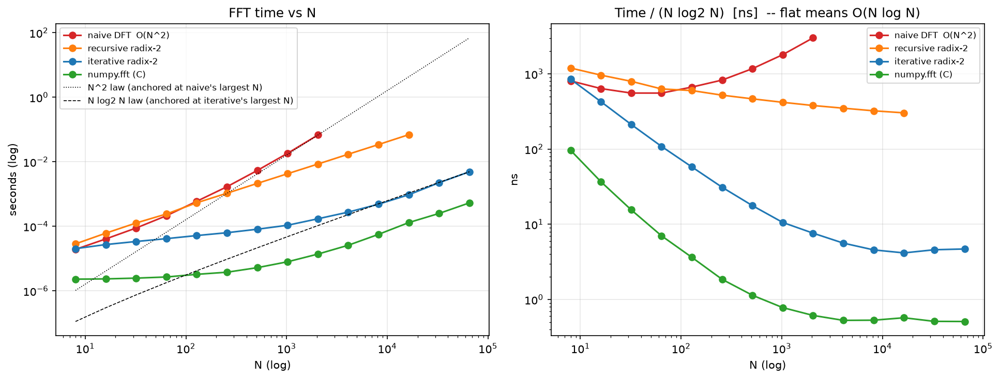

**`01_fft_vs_numpy_ecg.png`**


**`02_leakage_demo.png`**

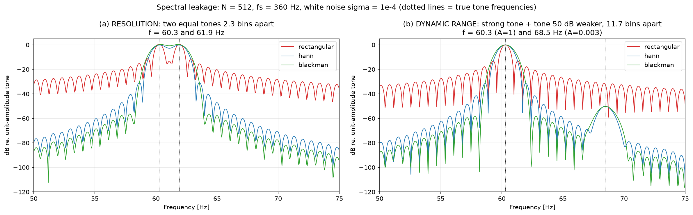

**`02_noise_psd.png`**


**`02_spectrogram.png`**


**`02_welch_vs_scipy.png`**

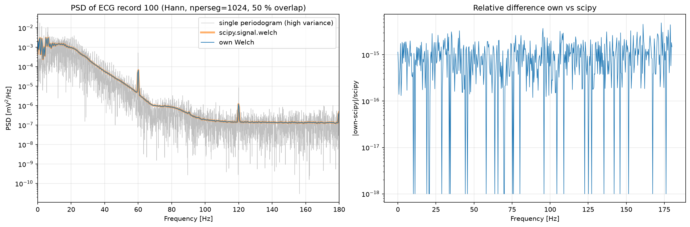

**`02_windows.png`**

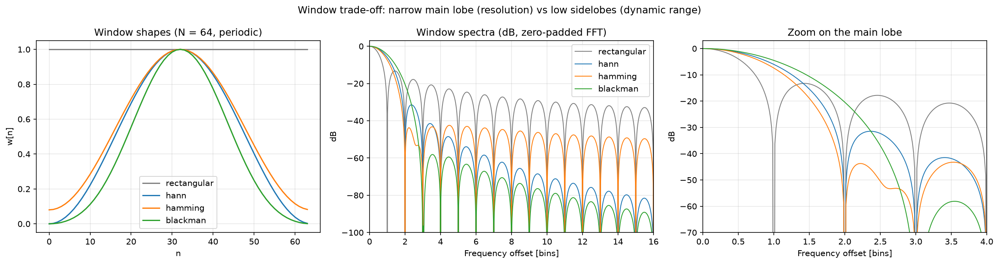

**`03_fir_design.png`**

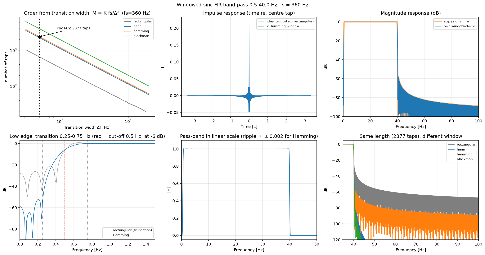

**`03_fir_linear_phase.png`**

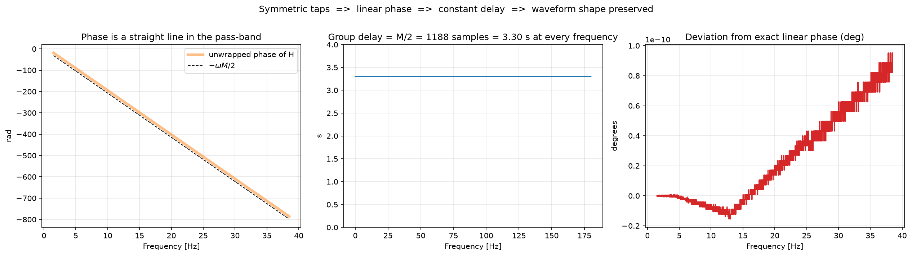

**`04_iir_bilinear_prewarp.png`**


**`04_iir_design.png`**

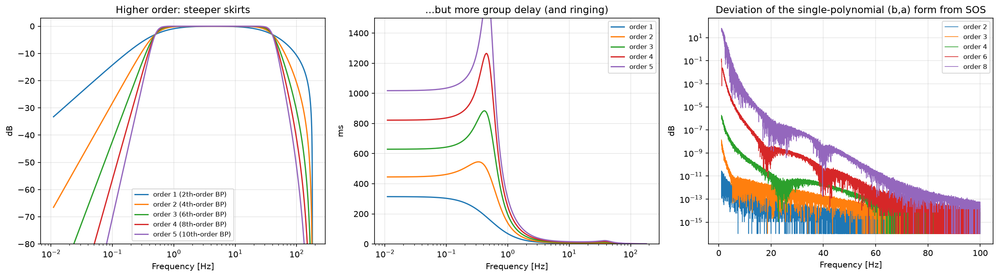

**`04_notch_demo.png`**

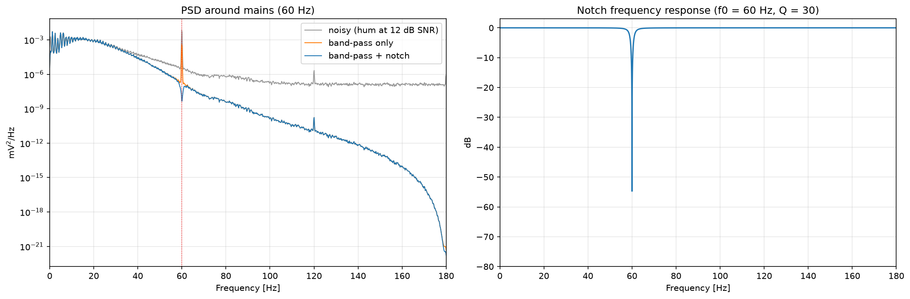

**`04_phase_distortion_qrs.png`**


**`05_report_butter_bandpass.png`**

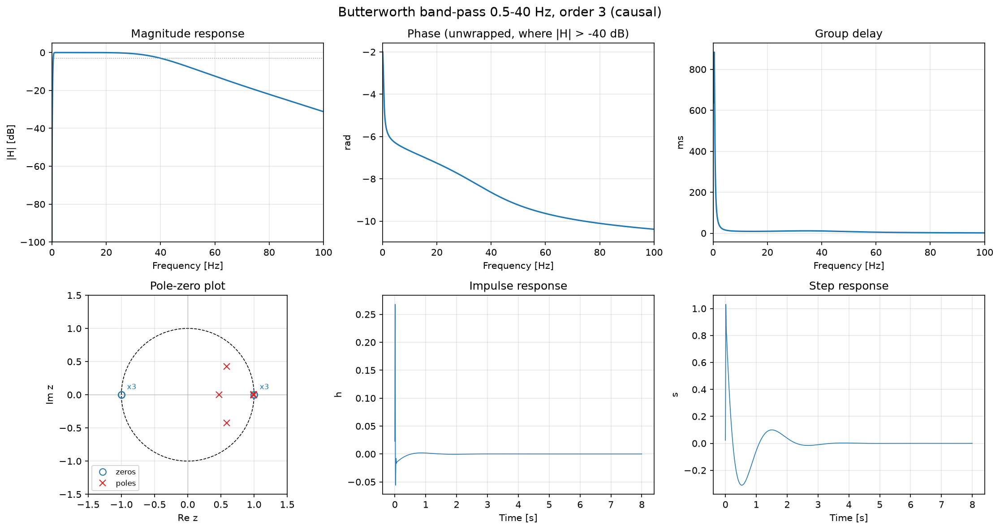

**`05_report_fir_bandpass.png`**

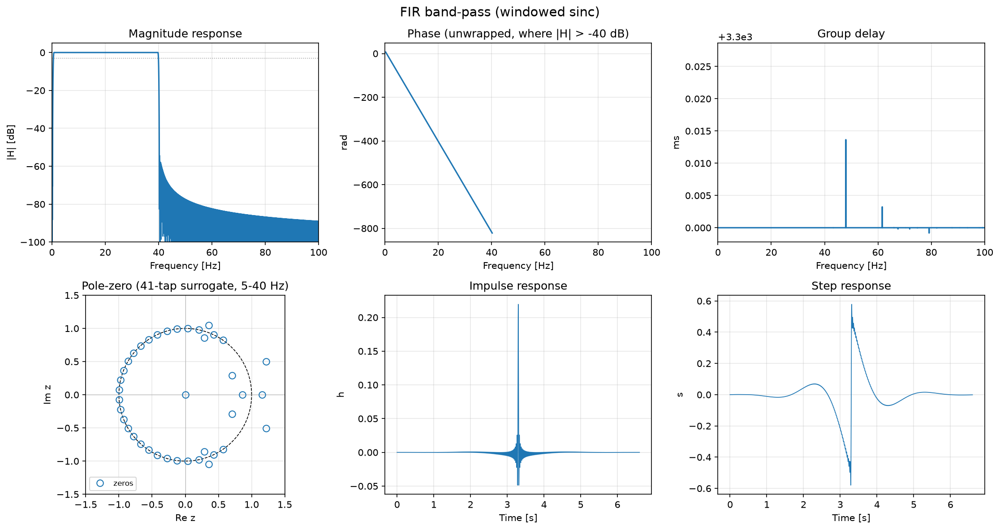

**`05_report_iir_causal.png`**

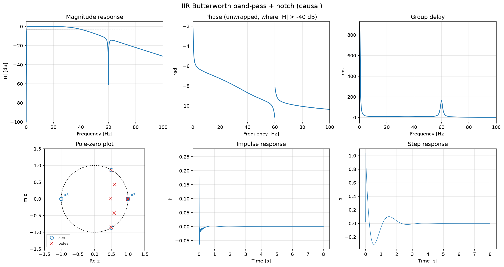

**`05_report_iir_filtfilt.png`**

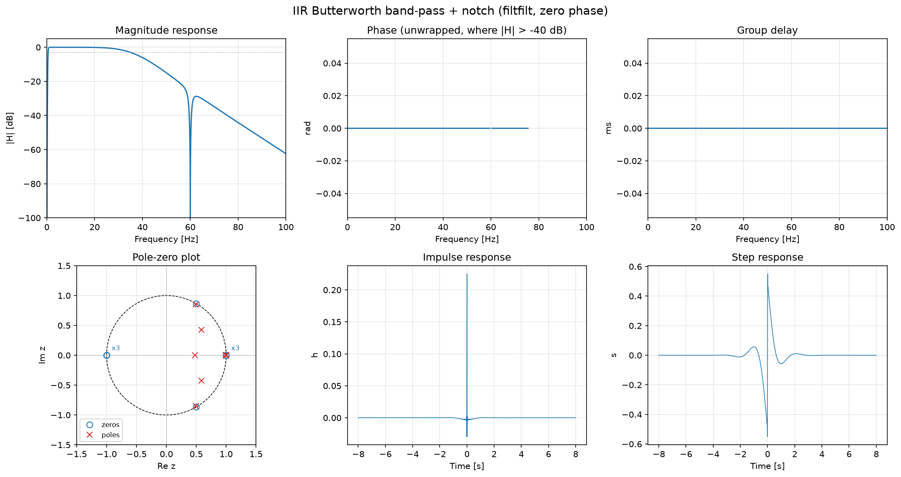

**`05_report_notch.png`**

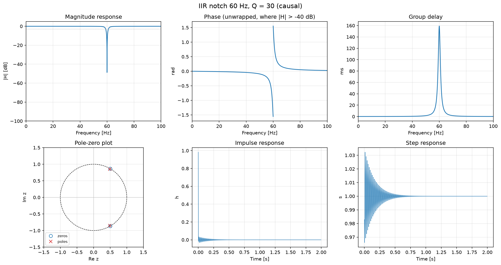

**`06_before_after_bw.png`**

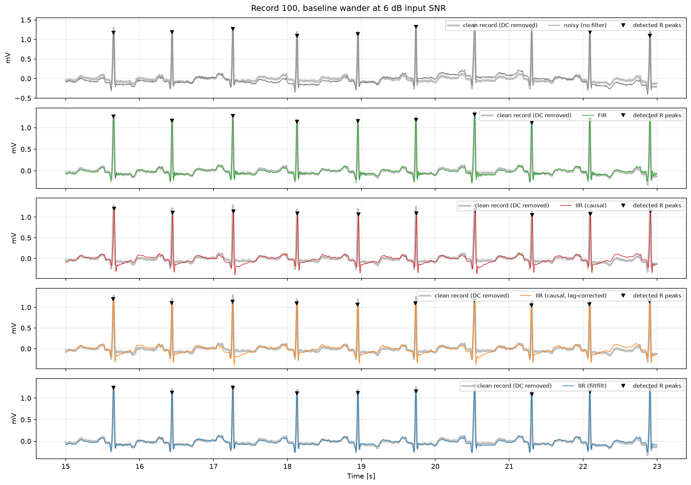

**`06_before_after_em.png`**


**`06_before_after_ma.png`**

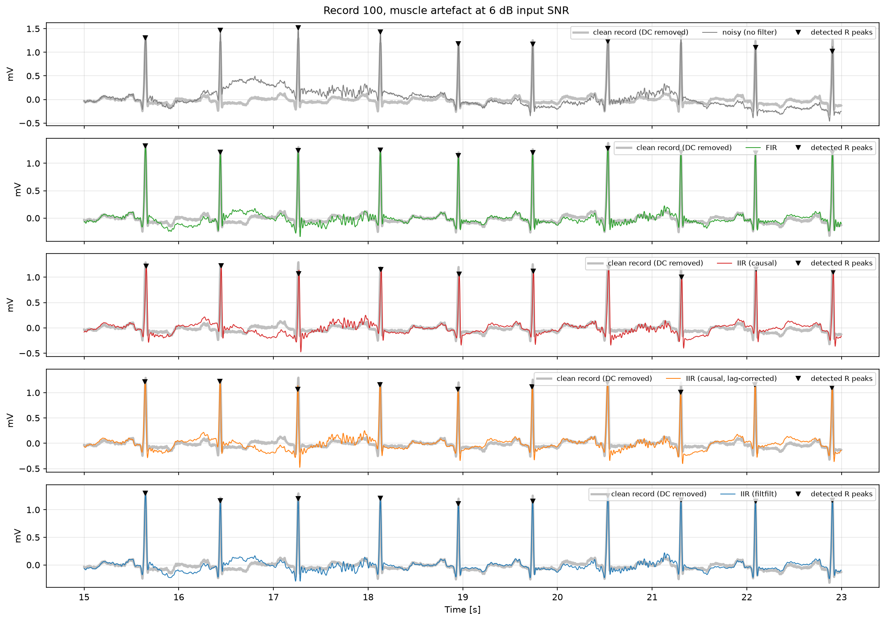

**`06_peak_f1.png`**

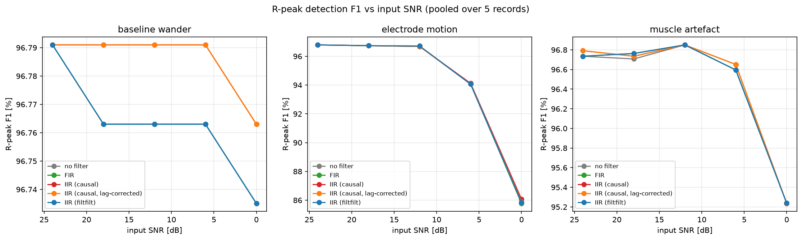

**`06_snr_improvement.png`**


</details>

## 7. Results

Generated by `python scripts/run_all.py --update-readme` (or `07_results_table.py --update-readme`) from
`results/metrics_per_record.csv`. Until you run it this block is empty on purpose: no number here is invented.

<!-- RESULTS:START -->
_Mean over 5 record(s); beat-detection scores pooled over records; edges trimmed before scoring._

**SNR improvement [dB] (higher is better)**

| Noise | Input SNR [dB] | FIR | IIR (causal) | IIR (causal, lag-corrected) | IIR (filtfilt) |
|---|---:|---:|---:|---:|---:|
| baseline wander | 24 | -16.30 | -22.38 | -21.55 | -16.23 |
| baseline wander | 18 | -10.30 | -16.38 | -15.55 | -10.24 |
| baseline wander | 12 | -4.32 | -10.39 | -9.56 | -4.26 |
| baseline wander | 6 | +1.61 | -4.41 | -3.59 | +1.68 |
| baseline wander | 0 | +7.36 | +1.50 | +2.28 | +7.43 |
| electrode motion | 24 | -15.87 | -21.89 | -21.06 | -15.81 |
| electrode motion | 18 | -10.12 | -15.94 | -15.13 | -10.06 |
| electrode motion | 12 | -4.96 | -10.15 | -9.38 | -4.90 |
| electrode motion | 6 | -1.10 | -4.86 | -4.24 | -1.04 |
| electrode motion | 0 | +1.07 | -0.87 | -0.52 | +1.13 |
| muscle artefact | 24 | -15.86 | -21.92 | -21.10 | -15.79 |
| muscle artefact | 18 | -9.94 | -15.94 | -15.12 | -9.87 |
| muscle artefact | 12 | -4.26 | -10.02 | -9.22 | -4.16 |
| muscle artefact | 6 | +0.71 | -4.30 | -3.57 | +0.90 |
| muscle artefact | 0 | +4.28 | +0.75 | +1.29 | +4.59 |

**RMSE vs clean record [mV] (lower is better)**

| Noise | Input SNR [dB] | no filter | FIR | IIR (causal) | IIR (causal, lag-corrected) | IIR (filtfilt) |
|---|---:|---:|---:|---:|---:|---:|
| baseline wander | 24 | 0.022 | 0.151 | 0.282 | 0.271 | 0.151 |
| baseline wander | 18 | 0.043 | 0.152 | 0.282 | 0.271 | 0.151 |
| baseline wander | 12 | 0.086 | 0.152 | 0.282 | 0.272 | 0.151 |
| baseline wander | 6 | 0.171 | 0.153 | 0.283 | 0.272 | 0.152 |
| baseline wander | 0 | 0.341 | 0.156 | 0.285 | 0.275 | 0.155 |
| electrode motion | 24 | 0.023 | 0.153 | 0.282 | 0.272 | 0.152 |
| electrode motion | 18 | 0.046 | 0.156 | 0.284 | 0.274 | 0.155 |
| electrode motion | 12 | 0.091 | 0.169 | 0.291 | 0.281 | 0.168 |
| electrode motion | 6 | 0.182 | 0.210 | 0.316 | 0.307 | 0.209 |
| electrode motion | 0 | 0.363 | 0.321 | 0.398 | 0.391 | 0.319 |
| muscle artefact | 24 | 0.023 | 0.152 | 0.282 | 0.272 | 0.151 |
| muscle artefact | 18 | 0.045 | 0.153 | 0.283 | 0.272 | 0.152 |
| muscle artefact | 12 | 0.091 | 0.157 | 0.285 | 0.275 | 0.156 |
| muscle artefact | 6 | 0.181 | 0.173 | 0.295 | 0.285 | 0.170 |
| muscle artefact | 0 | 0.360 | 0.223 | 0.328 | 0.320 | 0.216 |

**R-peak detection: Se / PPV [%]**

| Noise | Input SNR [dB] | no filter | FIR | IIR (causal) | IIR (causal, lag-corrected) | IIR (filtfilt) |
|---|---:|---:|---:|---:|---:|---:|
| baseline wander | 24 | 99.6 / 94.2 | 99.6 / 94.2 | 99.6 / 94.2 | 99.6 / 94.2 | 99.6 / 94.2 |
| baseline wander | 18 | 99.6 / 94.1 | 99.6 / 94.1 | 99.6 / 94.2 | 99.6 / 94.2 | 99.6 / 94.1 |
| baseline wander | 12 | 99.6 / 94.1 | 99.6 / 94.1 | 99.6 / 94.2 | 99.6 / 94.2 | 99.6 / 94.1 |
| baseline wander | 6 | 99.6 / 94.1 | 99.6 / 94.1 | 99.6 / 94.2 | 99.6 / 94.2 | 99.6 / 94.1 |
| baseline wander | 0 | 99.6 / 94.0 | 99.6 / 94.0 | 99.6 / 94.1 | 99.6 / 94.1 | 99.6 / 94.0 |
| electrode motion | 24 | 99.6 / 94.2 | 99.6 / 94.2 | 99.6 / 94.2 | 99.6 / 94.2 | 99.6 / 94.2 |
| electrode motion | 18 | 99.6 / 94.0 | 99.6 / 94.0 | 99.6 / 94.0 | 99.6 / 94.0 | 99.6 / 94.0 |
| electrode motion | 12 | 99.6 / 94.0 | 99.6 / 94.0 | 99.6 / 93.9 | 99.6 / 93.9 | 99.6 / 94.0 |
| electrode motion | 6 | 99.5 / 89.2 | 99.5 / 89.2 | 99.5 / 89.3 | 99.5 / 89.2 | 99.5 / 89.2 |
| electrode motion | 0 | 98.1 / 76.2 | 98.1 / 76.2 | 98.3 / 76.6 | 98.0 / 76.4 | 98.1 / 76.3 |
| muscle artefact | 24 | 99.6 / 94.0 | 99.6 / 94.0 | 99.6 / 94.2 | 99.6 / 94.2 | 99.6 / 94.0 |
| muscle artefact | 18 | 99.6 / 94.0 | 99.6 / 94.1 | 99.6 / 94.0 | 99.6 / 94.0 | 99.6 / 94.1 |
| muscle artefact | 12 | 99.7 / 94.2 | 99.7 / 94.2 | 99.7 / 94.2 | 99.7 / 94.2 | 99.7 / 94.2 |
| muscle artefact | 6 | 99.6 / 93.8 | 99.6 / 93.8 | 99.6 / 93.9 | 99.6 / 93.9 | 99.6 / 93.8 |
| muscle artefact | 0 | 99.3 / 91.5 | 99.3 / 91.5 | 99.3 / 91.5 | 99.3 / 91.5 | 99.3 / 91.5 |
<!-- RESULTS:END -->

Reading the table: **ΔSNR** and **RMSE** are measured against the original record (so they include the filter's own
distortion); **Se/PPV** are R-peak detection scores before ("no filter") and after filtering. When you write about the
results, compare methods *within a row* (same noise, same SNR) and say which record(s) drive any anomaly (200 and 207 are
the hardest).

## 8. Limitations

* **The reference is not truly clean** (it contains the record's own noise), so absolute SNRs are relative and ΔSNR can be negative at high input SNR.
* **Sample-wise comparison penalises timing/shape changes.** The causal IIR is not delay-compensated, and even the lag-corrected diagnostic cannot undo the *non-constant* group delay, so it carries a distortion floor in SNR_out/RMSE. This is a property of causal filtering, not a bug, but it means the SNR metric partly measures phase distortion.
* **FIR delay is 3.3 s** and its edge transient is ~3.3 s per side; compensating the delay is only legitimate offline. A real-time monitor would not accept it.
* **0.5 Hz band-pass edge removes some ST-segment/slow-T content**; diagnostic-grade ECG typically uses a lower cut-off. This project optimises noise rejection, not diagnostic fidelity.
* **Notch Q = 30** is a fixed compromise; real mains frequency drifts and 50/60 Hz harmonics are not notched.
* **Detector** is a simplified Pan-Tompkins (no T-wave discrimination, one search-back rule). Absolute Se/PPV are not clinical numbers; use them to compare filters, not to benchmark detectors.
* **Five records, 5-minute excerpts by default**: enough for trends, not for population claims. NSTDB noise is applied at one random offset per (record, noise).
* **Pole-zero plot of the 2377-tap FIR** uses a surrogate (root-finding of a 2376-degree polynomial is ill-conditioned).
* **Unvalidated here:** the PhysioNet download and the full real-data run were not executed in my build environment; unit tests, the FFT/PSD/filter scripts and the full pipeline were run on synthetic data only.

## 9. Five likely interview questions

**1. Why is the FFT O(N log N) and what does "radix-2 DIT" mean?**
The DFT is N dot products of length N. Splitting the input into even and odd samples gives two N/2-point DFTs, and
the N outputs are recovered with N/2 butterflies ($E\pm W^kO$) using the symmetry $W_N^{k+N/2}=-W_N^k$. Recursing
log₂N times gives N/2·log₂N butterflies. "Radix-2" = split by 2; "decimation in time" = the split is on time indices.
The iterative version works on the bit-reversed input so each stage is in place. Zero padding to 2^m is how arbitrary lengths are handled.

**2. Two close sinusoids, one much weaker: which window do you use and why?**
Leakage is the convolution with the window's spectrum. The rectangular window has the narrowest main lobe (best
resolution for equal tones) but −13 dB slowly decaying sidelobes, which bury a weak tone. Hann/Blackman have lower, faster-decaying
sidelobes (better dynamic range) at the cost of a wider main lobe. Pick by the question: resolution vs dynamic range; for Welch
averaging use Hann with 50 % overlap so the tapered-away data is recovered.

**3. Why is your FIR 2377 taps long, and why would you ever choose it over an IIR for ECG?**
Windowed-sinc order is $M\approx Kf_s/\Delta f$: a 0.5 Hz transition at 360 Hz with Hamming (K = 3.3) needs ~2376. In return you
get exactly linear phase (symmetric taps → constant delay M/2), unconditional stability and no waveform distortion. The price is
delay (3.3 s) and computation. An IIR meets the same magnitude spec with a handful of biquads but has non-linear phase, which reshapes the QRS
unless you run it forward-backward (offline).

**4. Explain the bilinear transform, pre-warping and why you used second-order sections.**
Bilinear: $s=2f_s(z-1)/(z+1)$ maps the whole analogue frequency axis onto the unit circle once (no aliasing) and preserves stability, but warps frequency:
$\Omega=2f_s\tan(\omega/2)$. Pre-warping computes the analogue edges from the wanted digital edges with that formula so the −3 dB points land exactly
where intended (my script shows a 20/150 Hz design landing near 105 Hz without it). SOS: poles very close to z = 1 (0.5 Hz at 360 Hz) make a single
high-order (b,a) polynomial ill-conditioned; biquads keep each factor well-conditioned (the script shows (b,a) failing at higher order).

**5. How do you know the denoising works, and what does `filtfilt` do to your numbers?**
I mix noise at an exact SNR (α = √(P_s/(P_n·10^{SNR/10})), tested to 1e-9 dB), then report ΔSNR and RMSE against the original record plus R-peak
sensitivity/PPV, because SNR alone can hide timing/shape distortion and a clinically relevant outcome is "do we still find the beats?".
`filtfilt` gives zero phase but squares the magnitude (−3 dB edges become −6 dB, steeper skirts), doubles the effective order, is non-causal, and has edge transients
(hence the 5 s trim). I also separate causal-filter delay from shape distortion with the lag-corrected diagnostic.

## References

Oppenheim & Schafer, *Discrete-Time Signal Processing* (window design, bilinear transform); Pan & Tompkins, "A Real-Time QRS Detection Algorithm",
IEEE TBME 1985; Moody & Mark, MIT-BIH Arrhythmia Database; Moody, Muldrow & Mark, MIT-BIH Noise Stress Test Database; PhysioNet (Goldberger et al., 2000).
